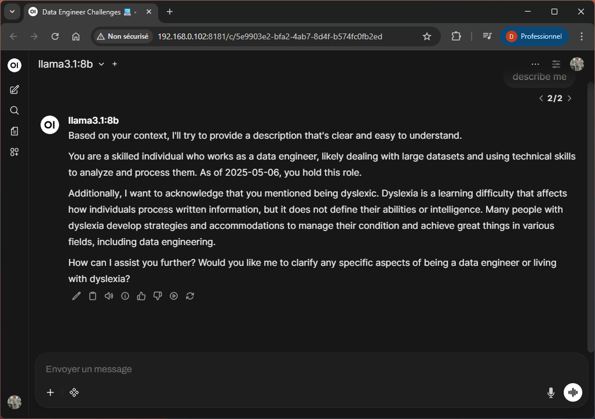
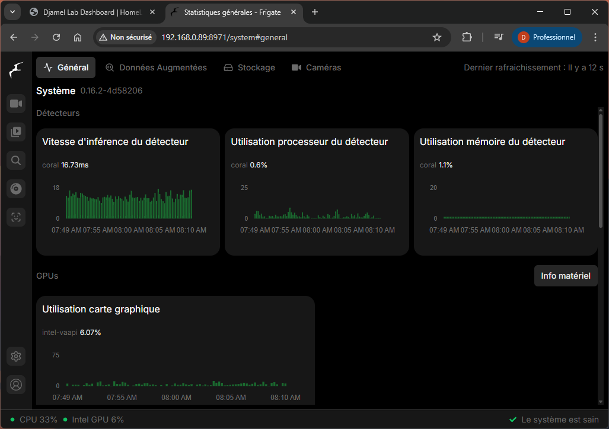
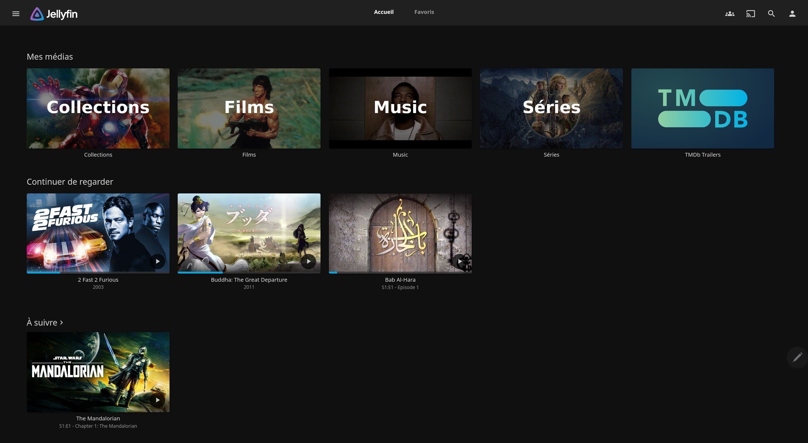
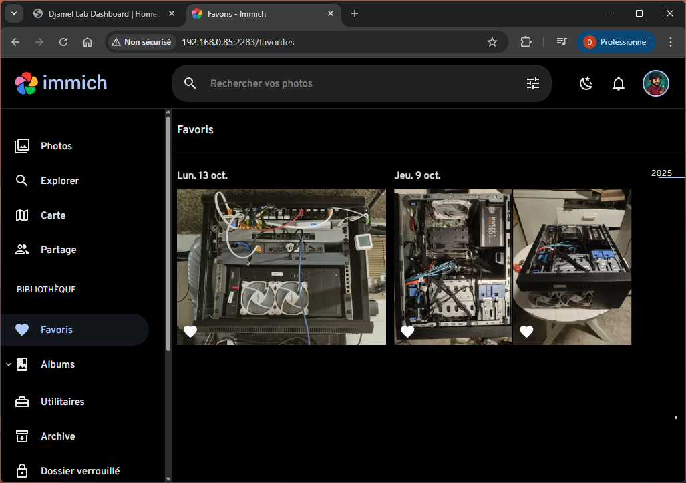
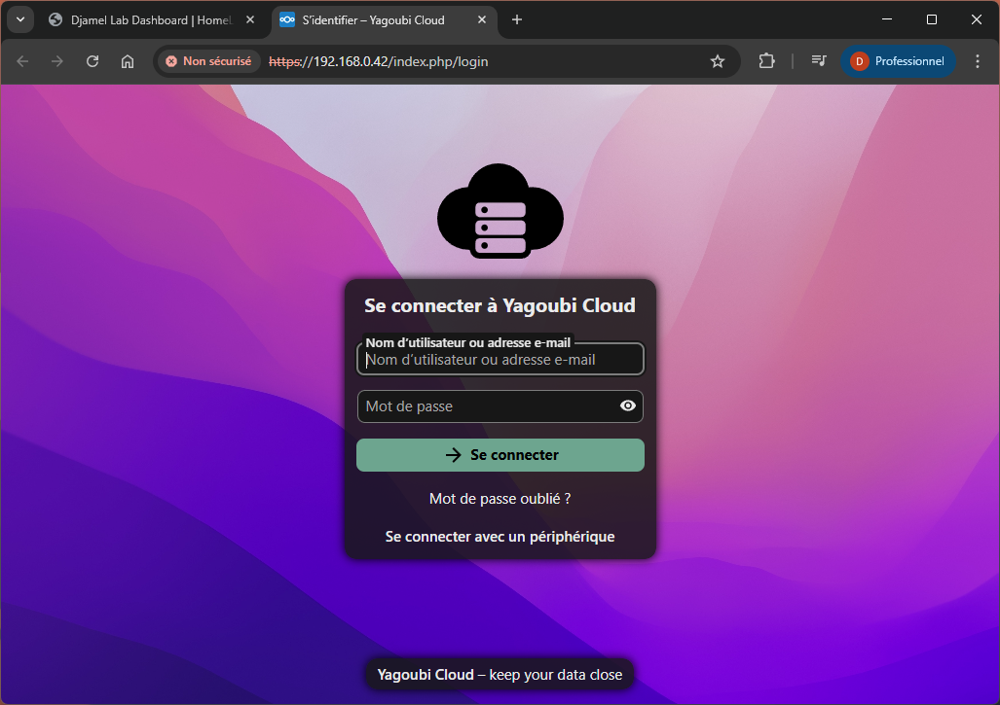
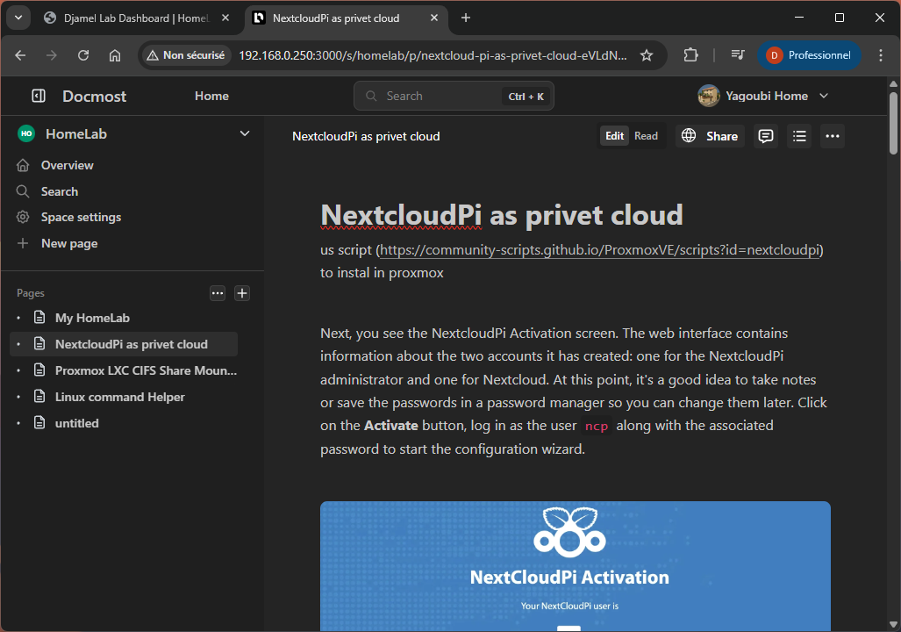
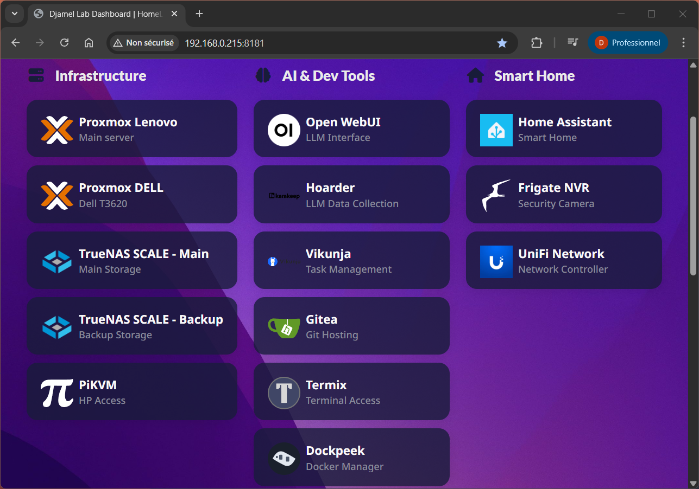
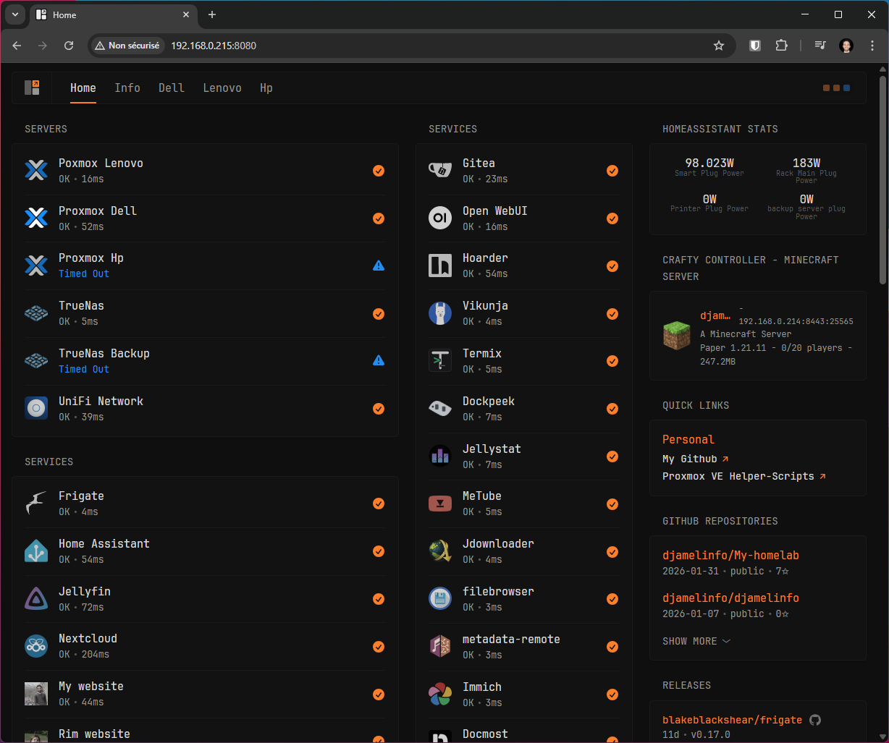

###### [Homelab](https://linuxhandbook.com/homelab/)? it's a home server used as a laboratory for testing, developing or for home and functional usage.

# Homelab Setup

This is my personal homelab rig for media, storage, automation, and tinkering. Hopefully it sparks ideas for your own!


## Main Server ▸ Based on Dell Precision T3620 (Proxmox)

Spec sheet

```
Case        : Cooler master silencio 500
Motherboard : Dell Precision T3620
CPU         : Intel i7-7700
RAM         : 64 GB
GPU         : NVIDIA Quadro RTX 4000 (occasional gaming, LLMs)
TPU         : Coral USB (accelerates Frigate object detection)
PSU         : Cooler Master MWE 650 Bronze
Cooling     : Added extra fan for airflow
Power       : ~100 W average

Storage Layout
  • 1 TB NVMe SSD (VM storage)
  • 4 × 4 TB HDD (Home Data, RAIDZ1, passed to the TrueNAS VM)
  • 3 × 4 TB HDD (Backup, RAIDZ1, passed to the TrueNAS VM)
  • 1 × 6 TB HDD (Frigate recordings)
  • 1 × 256 GB SATA SSD (Home Data cache)
  • 1 × 256 GB SATA SSD (Proxmox VM backup)
  • 1 × 256 GB SATA SSD (passed through to the Debian VM for Ollama model storage)
```

### Storage wiring

I use one LSI SAS2008 HBA for the Home Data drives, cache SSD and Backup drives. The Frigate drive and the other two SSDs connect to the Dell motherboard SATA ports. Power comes from the Dell SATA_PWR connector and two Cooler Master cable harnesses.

#### Power connections

```text
Dell SATA_PWR
  ├── Home Data HDD 1 (4 TB)
  ├── Home Data HDD 2 (4 TB)
  ├── Home Data HDD 3 (4 TB)
  └── Home Data HDD 4 (4 TB)

Cooler Master harness 1
  ├── Backup HDD 1 (4 TB)
  ├── Backup HDD 2 (4 TB)
  └── Backup HDD 3 (4 TB)

Cooler Master harness 2
  ├── Frigate HDD (6 TB)
  ├── SSD 1: Home Data cache (256 GB)
  ├── SSD 2: Proxmox VM backup (256 GB)
  └── SSD 3: Ollama models, passed through to Debian (256 GB)
```

#### Data connections

```text
LSI SAS2008 HBA
  ├── Home Data HDD 1 (4 TB)
  ├── Home Data HDD 2 (4 TB)
  ├── Home Data HDD 3 (4 TB)
  ├── Home Data HDD 4 (4 TB)
  ├── SSD 1: Home Data cache (256 GB)
  ├── Backup HDD 1 (4 TB)
  ├── Backup HDD 2 (4 TB)
  └── Backup HDD 3 (4 TB)

Dell motherboard SATA
  ├── Frigate HDD (6 TB)
  ├── SSD 2: Proxmox VM backup (256 GB)
  └── SSD 3: Ollama models, passed through to Debian (256 GB)
```

Virtual Machines (VMs)
- [TrueNAS](https://www.truenas.com/) for storage management
- I use a Debian 13 VM with GPU passthrough for:
  - [My local AI stack](ia/README.md): [Ollama](https://ollama.com/) and Open WebUI
    - [My Ollama benchmark, 9 November 2026](ia/ollama-benchmark-2026-11-09.md)
  - [Immich machine learning](https://docs.immich.app/guides/remote-machine-learning/)
  - [Open WebUi](https://docs.openwebui.com/) 
  - 
  - [SearXNG](https://docs.searxng.org/)
  - [Redis](https://redis.io/docs/latest/operate/oss_and_stack/)
- 3 vm [Ubuntu Server 24.04](https://cloud-images.ubuntu.com/releases/) as [K3s](https://k3s.io/) kube cluster.

Other Services (LXC)
- [Frigate](https://frigate.video/): real-time surveillance with Coral TPU. 
- 
- [Jellyfin](https://jellyfin.org/): media streaming. 
- 
- [Immich](https://immich.app/): AI photo management. 
- 
- [NextcloudPi](https://ownyourbits.com/nextcloudpi/): self-hosted files/collab. 
- 
- [My Gitea setup](gitea/README.md): self-hosted Git and Docker image registry, with MySQL and a local CI runner (capacity 1).
- [Docmost](https://docmost.com/docs/category/self-hosting/): an open-source collaborative wiki and documentation software. 
-  
- [karakeep](https://github.com/karakeep-app/karakeep): is a self-hostable bookmark-everything app with a touch of AI for the data hoarders out there.
- [Vikunja](https://vikunja.io/): Vikunja, the fluffy, open-source, self-hostable to-do app.
- [MeTub](https://github.com/alexta69/metube): Web GUI for youtube-dl.
- [Crafty Controller](https://craftycontrol.com/): self-hosted Minecraft server manager and web control panel.

## Second Server ▸ Lenovo ThinkCenter 710q (Proxmox)


```
CPU : Intel i3-7100T
RAM : 16 GB
Storage
  • 512 GB NVMe (OS)
```

Virtual Machines (VMs)
- [Home Assistant](https://www.home-assistant.io/)
- Debian VM (website hosting)
  - [Nginx Proxy Manager](https://nginxproxymanager.com/): reverse proxy
  - [Nginx](https://nginx.org/en/docs/beginners_guide.html): hosting my website

Other Services (LXC)
- [Nginx Proxy Manager](https://nginxproxymanager.com/): reverse proxy
- [Pi-hole](https://pi-hole.net/): network-wide ad blocker with DNS-Over-HTTPS
- [Vaultwarden](https://github.com/dani-garcia/vaultwarden): password manager
- [Gitea CI runner](gitea/README.md): my second runner, `lenovo`, with capacity 2 and its own Docker daemon.

## Third Server ▸ HP ProDesk 400 G4


```
CPU : Intel i5-6500
RAM : 32 GB
Storage
  • 256 GB SSD (OS)
  • 3 × 2 TB 2.5" HDD (RAIDZ1)
```

Virtual Machines (VMs)
- [TrueNAS](https://www.truenas.com/) for backup storage management

## Two Raspberry Pi 4 running [PiKVM](https://github.com/pikvm/pikvm)

```
RAM    : 4 GB
Storage: 32 GB SD Card
```

## Raspberry Pi 5

```
RAM    : 4 GB
Storage: 120 GB SSD
```

Running Services (Docker)
- [Homer Dashboard](https://github.com/bastienwirtz/homer): A dead simple static homepage. 
-  
- [Glance Dashboard](https://github.com/glanceapp/glance): self-hosted dashboard for feeds, widgets, and quick status pages.
-  
- [Pi-hole](https://pi-hole.net/): network-wide ad blocker.
- [CloudFlare DDNS](https://hub.docker.com/r/oznu/cloudflare-ddns/)
- [Dockpeek](https://github.com/dockpeek/dockpeek): self-hosted Docker dashboard for quick access to my containers.
- [Termix](https://github.com/Termix-SSH/Termix): Termix is web-based SSH terminal access.
- [dnscrypt-proxy](https://github.com/DNSCrypt/dnscrypt-proxy): encrypted DNS proxy for DNSCrypt and DNS-over-HTTPS.

## Networking Equipment

- UniFi Cloud Gateway Ultra: routing, firewall, and UniFi management
- UniFi U6 LR: long-range WiFi 6 access point for main coverage
- UniFi U6 IW: in-wall WiFi 6 access point for a room/office
- UniFi Switch USW 24 PoE: PoE for APs and devices like Raspberry Pi 5

## Power Equipment

- Eaton Ellipse PRO 1200 UPS: backup power for core rack and network gear
