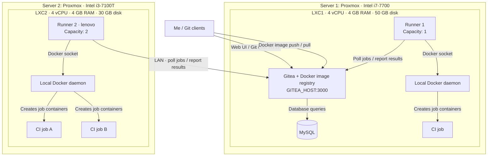

# My Gitea setup

I run Gitea with MySQL in an LXC container on my main Proxmox server. My CI jobs run through two runners: one in the same LXC as Gitea, and another in a separate LXC on my Lenovo server.

I also use Gitea as my Docker image registry to store and distribute my container images.

Each runner uses a Docker daemon inside its own LXC to create job containers. The Lenovo runner contacts Gitea over the LAN to poll for jobs and report results.

## Architecture

I use `GITEA_HOST:3000` as a placeholder for my Gitea LAN address in this public diagram.

## Container resources

| Component | Main server LXC | Lenovo LXC |
|---|---|---|
| Host | Dell Precision T3620, Intel i7-7700 | Lenovo ThinkCenter 710q, Intel i3-7100T |
| vCPU | 4 | 4 |
| RAM | 4 GB | 4 GB |
| Disk | 50 GB | 30 GB |
| Services | Gitea with Docker image registry, MySQL, Runner 1, Docker | Runner 2 (`lenovo`), Docker |
| Runner capacity | 1 job | 2 jobs |

I have three CI job slots across the two runners: one on the main server and two on the Lenovo. These are runner limits; jobs still share the CPU, RAM and disk allocated to their LXC.

## How my jobs run

I access Gitea through its web interface or a Git client over HTTP. Gitea stores its database in MySQL. Both runners poll Gitea for work and send their results back to it.

Runner 1 starts its job container through the Docker daemon in LXC1. The `lenovo` runner uses the Docker daemon in LXC2 and can run two job containers at once. Each job therefore runs on the server hosting its runner.

[Back to my homelab](../README.md)
