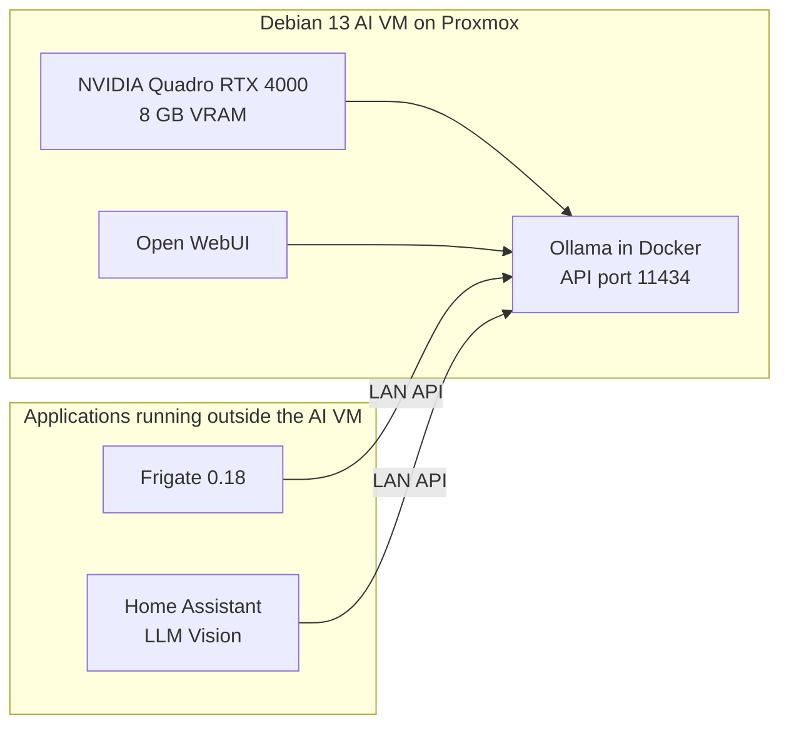

# Local AI in my homelab

I run Ollama on a Debian 13 VM with an NVIDIA Quadro RTX 4000. Its 8 GB of VRAM serve Open WebUI, Frigate image descriptions and Home Assistant LLM Vision. Frigate runs in its own LXC container and Home Assistant in a separate VM; both reach Ollama over the LAN.

## Architecture



| Component | Configuration |
|---|---|
| Hypervisor | Proxmox |
| AI VM | Debian 13 minimal, 4 vCPUs |
| GPU | NVIDIA Quadro RTX 4000, 8 GB |
| Inference server | Ollama in Docker |
| Production model | `qwen3-vl:8b-instruct`, Q4_K_M |
| Ollama context | 8192 tokens |
| Parallel requests / loaded models | 1 / 1 |
| Clients | Open WebUI, Frigate 0.18.2, Home Assistant LLM Vision |

## Running within 8 GB of VRAM

With the production model loaded, `nvidia-smi` reports about 7296 MiB in use out of 8192 MiB. I keep `OLLAMA_NUM_PARALLEL=1` and `OLLAMA_MAX_LOADED_MODELS=1` to stay within that memory budget. Requests wait when several cameras need descriptions at once.

Frigate sends `keep_alive: 24h` with its requests. Keeping the model resident avoids a reload that took roughly 17 to 19 seconds in my tests. This is a client setting: requests from other clients can use a different lifetime or fall back to the server default.

## Frigate image handling

The main problem was the number of images sent in a single request. A review containing 37 images needed 39541 tokens, far beyond the 8192-token context. Some object descriptions also exceeded the limit with eight or ten images.

I now use separate values for Frigate's review planning and the context passed to Ollama. This fragment belongs in my existing Ollama provider configuration:

```yaml
provider_options:
  keep_alive: 24h
  options:
    num_ctx: 4096

runtime_options:
  options:
    num_ctx: 8192
    num_predict: 256
    temperature: 0.1
```

In Frigate 0.18.2, the provider value feeds the review frame budget, while the runtime value is sent to Ollama. My subsequent reviews used three images each and completed successfully. Ollama still runs with an 8192-token context. This workaround relies on the behaviour of that Frigate version.

For FrontCam, I also enabled snapshots in the existing camera configuration:

```yaml
cameras:
  FrontCam:
    objects:
      genai:
        use_snapshot: true
```

Object descriptions then use a single snapshot, losing the movement context of a sequence. Review summaries have their own image selection. In the latest test, all four single-image descriptions and all five three-image reviews completed. One eight-image object request still exceeded the context limit, so the issue remains for multi-image requests elsewhere in the setup.

## Model comparison

I compared four installed models using a synthetic image and three public photographs, then measured warm performance directly on the Debian VM.

| Model | Image checks passed, out of 13 | Text generation | Median vision TTFT | Peak VRAM |
|---|---:|---:|---:|---:|
| `qwen3.5:9b` | 12 | 43.96 tok/s | 0.719 s | 6610 MiB |
| `qwen3-vl:8b-instruct` | 11 | 32.35 tok/s | 2.188 s | 7244 MiB |
| `qwen3-vl:4b-instruct` | 10 | 86.71 tok/s | 1.125 s | 5236 MiB |
| `gemma4:e2b` | 9 | 140.51 tok/s | 0.250 s | 3264 MiB |

The 9B passed the most checks in this small image set and used less VRAM than my production 8B. Gemma was fastest, but made more mistakes on the photographs. I still use `qwen3-vl:8b-instruct` for Frigate and LLM Vision; the other models were compared with controlled prompts.

The [benchmark article](ollama-benchmark-2026-11-09.md) covers the measurements, image checks and Frigate context errors.

## Monitoring

I use the NVIDIA driver readings for total GPU memory:

```bash
nvidia-smi
```

Ollama exposes the loaded model and installed models through its API. Replace `OLLAMA_HOST` with the server address:

```bash
curl -s http://OLLAMA_HOST:11434/api/ps | jq
curl -s http://OLLAMA_HOST:11434/api/tags | jq
```

For image counts and request options in Frigate:

```yaml
logger:
  logs:
    frigate.genai.plugins.ollama: debug
```
