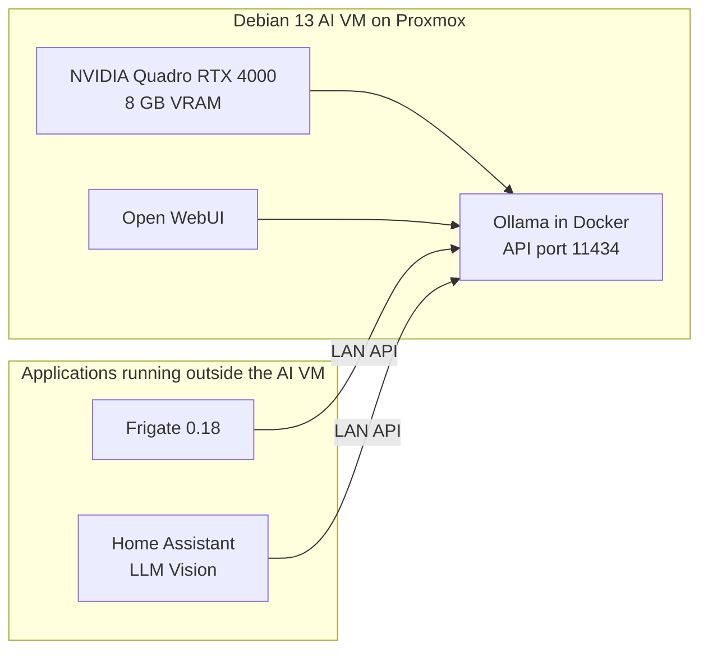

# Local AI stack

- [Ollama benchmark, 9 November 2026](ollama-benchmark-2026-11-09.md)

## Architecture



The Debian VM runs Ollama and Open WebUI. Frigate is an LXC service, and Home Assistant runs in another VM. Both call Ollama over the LAN for image analysis.

| Component | Current configuration |
|---|---|
| Hypervisor | Proxmox |
| AI VM | Debian 13 minimal |
| GPU | NVIDIA Quadro RTX 4000, 8 GB |
| Inference server | Ollama in Docker |
| Production model | `qwen3-vl:8b-instruct`, Q4_K_M |
| Context loaded | `8192` tokens |
| Parallel requests | `1` |
| Loaded models | `1` |
| Local applications | Ollama, Open WebUI |
| Remote Ollama clients | Frigate 0.18, Home Assistant LLM Vision |

## Ollama settings

The intended Docker configuration is:

```yaml
services:
  ollama:
    image: ollama/ollama:latest
    restart: unless-stopped
    gpus: all
    ports:
      - "11434:11434"
    volumes:
      - /srv/ai/ollama:/root/.ollama
    environment:
      OLLAMA_KEEP_ALIVE: "24h"
      OLLAMA_MAX_LOADED_MODELS: "1"
      OLLAMA_NUM_PARALLEL: "1"
      OLLAMA_MAX_QUEUE: "10"
```

Use `num_ctx: 8192` in the client request or model configuration when the full context is required.

> [!IMPORTANT]
> During the benchmark, requests that omitted `keep_alive` expired after about five minutes. A previous client request had kept the model loaded for 24 hours. The container may still be using `OLLAMA_KEEP_ALIVE=5m`, so check its environment after recreating it.

## Capacity and operating rules

The supplied `nvidia-smi` snapshot showed `7296 MiB / 8192 MiB` in use, leaving `896 MiB` free. Ollama `/api/ps` reported `5.74 GiB` for the model itself, which does not include all GPU memory used by the process.

- Leave `OLLAMA_NUM_PARALLEL` at `1`.
- Leave `OLLAMA_MAX_LOADED_MODELS` at `1`.
- Use the 24-hour lifetime while remote requests stay responsive and the server reports no out-of-memory errors.
- If GPU memory becomes tight, reduce the lifetime to between 30 minutes and 2 hours.
- Try `num_ctx=4096` only if real `prompt_eval_count` values stay comfortably below roughly 3000 tokens.
- Do not switch models during a Frigate or Home Assistant vision request. Since Ollama loads one model at a time, the new model evicts the production model.

## Benchmark status

A repeated benchmark ran locally on Debian while GPU and CPU use were sampled every 200 ms.

| Model | Combined image score | Text generation | Median vision TTFT | Peak VRAM from `nvidia-smi` |
|---|---:|---:|---:|---:|
| `qwen3.5:9b` | 12/13 | 43.96 tok/s | 0.719 s | 6 610 MiB |
| `qwen3-vl:8b-instruct` | 11/13 | 32.35 tok/s | 2.188 s | 7 244 MiB |
| `qwen3-vl:4b-instruct` | 10/13 | 86.71 tok/s | 1.125 s | 5 236 MiB |
| `gemma4:e2b` | 9/13 | 140.51 tok/s | 0.250 s | 3 264 MiB |

`qwen3.5:9b` was the most accurate model and answered the image tests about three times faster than the 8B. The 8B used almost all four vCPUs during text generation while averaging only 45.6% GPU use. Keep it in production until both models have been compared on anonymised Frigate frames and the exact Home Assistant prompts.

## Monitoring

On the Debian VM, check total GPU use with:

```bash
nvidia-smi
```

Check which model Ollama has loaded:

```bash
curl -s http://OLLAMA_HOST:11434/api/ps | jq
```

List the installed models:

```bash
curl -s http://OLLAMA_HOST:11434/api/tags | jq
```

See the [Ollama benchmark](ollama-benchmark-2026-11-09.md) for the measurements and model rankings.

