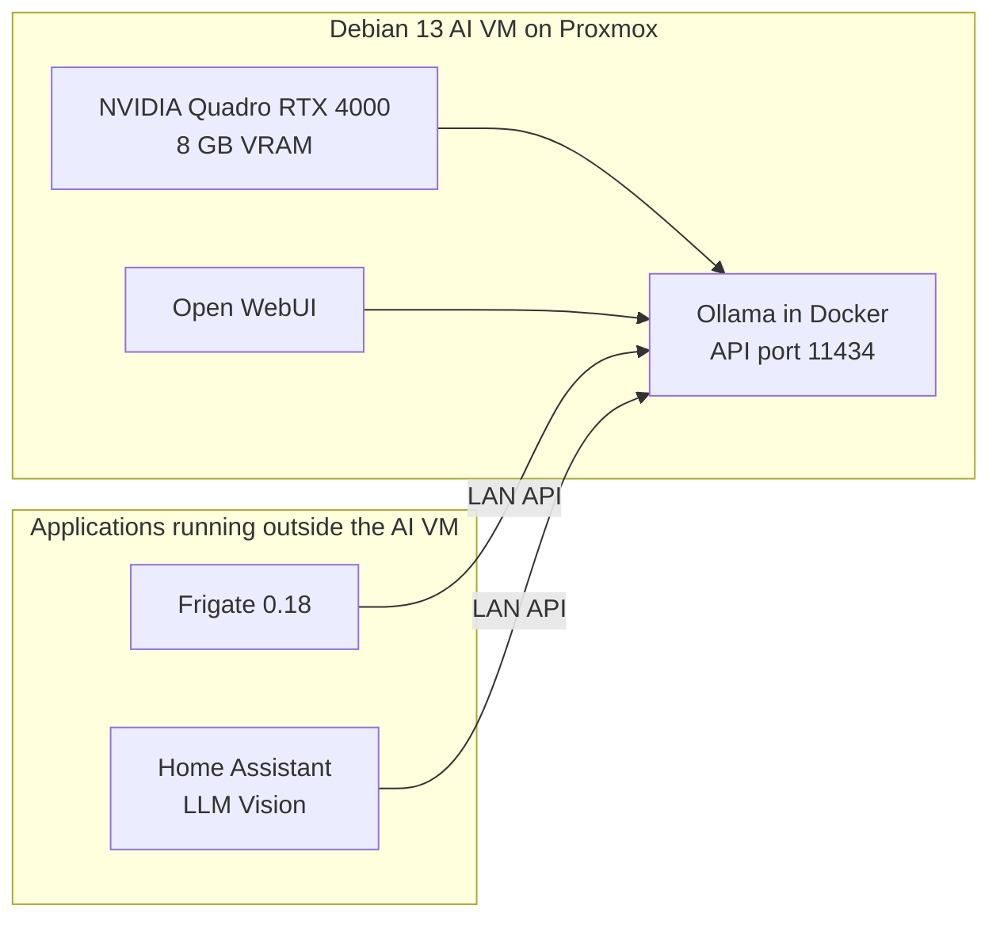

# My local AI stack

- [My Ollama benchmark, 9 November 2026](ollama-benchmark-2026-11-09.md)

## Architecture



I run Ollama and Open WebUI in a Debian 13 VM. Frigate runs in an LXC container, while Home Assistant runs in another VM. Both use my Ollama server over the LAN for image analysis.

| Component | Current configuration |
|---|---|
| Hypervisor | Proxmox |
| AI VM | Debian 13 minimal |
| GPU | NVIDIA Quadro RTX 4000, 8 GB |
| Inference server | Ollama in Docker |
| Production model | `qwen3-vl:8b-instruct`, Q4_K_M |
| Context loaded | `8192` tokens |
| Parallel requests | `1` |
| Loaded models | `1` |
| Local applications | Ollama, Open WebUI |
| Remote Ollama clients | Frigate 0.18.2, Home Assistant LLM Vision |

## Ollama settings

This is the Docker configuration I intend to use:

```yaml
services:
  ollama:
    image: ollama/ollama:latest
    restart: unless-stopped
    gpus: all
    ports:
      - "11434:11434"
    volumes:
      - /srv/ai/ollama:/root/.ollama
    environment:
      OLLAMA_KEEP_ALIVE: "24h"
      OLLAMA_MAX_LOADED_MODELS: "1"
      OLLAMA_NUM_PARALLEL: "1"
      OLLAMA_MAX_QUEUE: "10"
```

I use `num_ctx: 8192` in the client request or model configuration when I need the full context.

> [!IMPORTANT]
> During my benchmark, requests without `keep_alive` expired after about five minutes. An earlier client request had kept the model loaded for 24 hours. My container may still be using `OLLAMA_KEEP_ALIVE=5m`, so I need to check its environment after recreating it.

## Capacity and operating rules

My `nvidia-smi` snapshot showed `7296 MiB / 8192 MiB` in use, leaving `896 MiB` free. Ollama `/api/ps` reported `5.74 GiB` for the model itself, but that figure does not include all the GPU memory used by the process.

- I keep `OLLAMA_NUM_PARALLEL` at `1`.
- I keep `OLLAMA_MAX_LOADED_MODELS` at `1`.
- I use the 24-hour lifetime while remote requests stay responsive and the server reports no out-of-memory errors.
- If GPU memory becomes tight, I will reduce the lifetime to between 30 minutes and 2 hours.
- I keep `num_ctx=8192` while investigating oversized Frigate requests. My real usage tests already exceed a 4096-token context.
- I avoid switching models during a Frigate or Home Assistant vision request. Ollama loads one model at a time, so a new model evicts the production model.

## Benchmark status

I ran a repeated benchmark locally on Debian while sampling GPU and CPU use every 200 ms.

| Model | Combined image score | Text generation | Median vision TTFT | Peak VRAM from `nvidia-smi` |
|---|---:|---:|---:|---:|
| `qwen3.5:9b` | 12/13 | 43.96 tok/s | 0.719 s | 6 610 MiB |
| `qwen3-vl:8b-instruct` | 11/13 | 32.35 tok/s | 2.188 s | 7 244 MiB |
| `qwen3-vl:4b-instruct` | 10/13 | 86.71 tok/s | 1.125 s | 5 236 MiB |
| `gemma4:e2b` | 9/13 | 140.51 tok/s | 0.250 s | 3 264 MiB |

`qwen3.5:9b` was the most accurate model and answered the image tests about three times faster than the 8B. The 8B used almost all four vCPUs during text generation while averaging only 45.6% GPU use. For now, I am keeping the 8B in production. I want to compare both models on anonymised Frigate frames and my exact Home Assistant prompts before I switch.

## My tests around the house

I also tested normal use by walking around the house while Frigate and Home Assistant LLM Vision remained active. Across two sessions, I observed 22 inference calls: 16 returned HTTP 200 and 6 were rejected for exceeding the 8192-token context. Matching Frigate logs confirmed that all six rejected calls came from Frigate. I have not yet attributed every successful call to an application or scored the descriptions for accuracy.

The second session's debug logs showed the difference between object descriptions and review summaries. One image used 1085 tokens and completed in 3.40 seconds. A structured review with 37 images required 39541 tokens and was rejected. A six-image object description took 26.27 seconds, including about 11.3 seconds before processing began in the model runner.

VRAM stayed at 7296 MiB in the sampled readings. My next test is to temporarily disable review GenAI on the cameras where it is enabled, measure object descriptions on their own, and then compare single-image descriptions. I have not applied those changes yet. Camera decoding errors also need investigation separately from Ollama.

The [real usage results](ollama-benchmark-2026-11-09.md#my-real-usage-tests-with-frigate-and-llm-vision) include both sessions and the matched image counts.

## Monitoring

On my Debian VM, I check total GPU use with:

```bash
nvidia-smi
```

I check which model Ollama has loaded with:

```bash
curl -s http://OLLAMA_HOST:11434/api/ps | jq
```

I list the installed models with:

```bash
curl -s http://OLLAMA_HOST:11434/api/tags | jq
```

My [Ollama benchmark](ollama-benchmark-2026-11-09.md) has the full measurements and model rankings.

