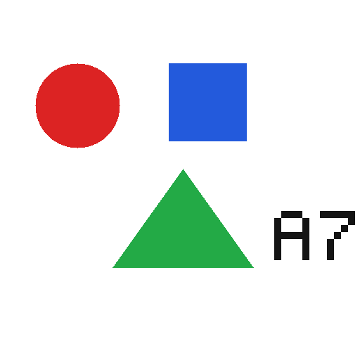

# Ollama benchmark, 9 November 2026

The test ran against the Ollama server on the Debian 13 AI VM.

| Item | Value |
|---|---|
| Ollama endpoint | LAN API on port `11434` |
| Ollama version | `0.40.15` |
| GPU | NVIDIA Quadro RTX 4000, 8 GB |
| Context | `num_ctx=8192` |
| Concurrency | `1` |
| Quantization | Q4_K_M for all tested models |

The test used only models that were already installed. It did not download, create or delete models, and it left the server configuration unchanged. Requests ran one at a time with a four-second pause. After the last test, the script loaded the production model again and restored its runtime `keep_alive` to 24 hours.

## Test method

For each model, the test sent:

1. A first text request, including the loading time when the model was not resident.
2. A hot text request in streaming mode to measure TTFT and generation speed.
3. A hot vision request using a synthetic image with no personal data.

The text request used a fixed French summarisation prompt, temperature 0 and at most 96 output tokens. The vision request used at most 64 output tokens.



Expected image answer:

```text
cercle=rouge; carre=bleu; triangle=vert; texte=A7
```

The client measured TTFT from the start of the request to the first non-empty streamed fragment. Ollama reports durations in nanoseconds. Generation speed used this formula:

```text
eval_count × 1,000,000,000 / eval_duration
```

## Synthetic image results

| Model | Cold load | Full cold request | Hot text TTFT | Hot text total | Generation | Vision TTFT | Vision total | Vision score | VRAM from `/api/ps` |
|---|---:|---:|---:|---:|---:|---:|---:|---:|---:|
| `qwen3-vl:8b-instruct` | 18.99 s | 21.91 s | 0.378 s | 3.332 s | 31.4 tok/s | 1.943 s | 2.551 s | 4/4 | 5.74 GiB |
| `qwen3-vl:4b-instruct` | 12.21 s | 13.53 s | 0.217 s | 1.294 s | 87.7 tok/s | 18.027 s | 18.252 s | 4/4 | 4.03 GiB |
| `gemma4:e2b` | 118.29 s | 140.20 s | 0.132 s | 0.791 s | 138.3 tok/s | 0.292 s | 0.432 s | 4/4 | 0.36 GiB* |
| `qwen3.5:9b` | 24.17 s | 26.51 s | 0.448 s | 1.994 s | 44.0 tok/s | 0.886 s | 1.275 s | 3/4 | 5.35 GiB |

\* The Gemma VRAM figure does not match its installed model file. The file is approximately 4.27 GiB, while `/api/ps` reported only 0.36 GiB. Confirm its total GPU use with `nvidia-smi` before relying on this figure.

## Synthetic image notes

### `qwen3-vl:8b-instruct`

It returned the correct image answer and behaved consistently while hot. It was the slowest text model in the test at roughly 31 to 34 tok/s. Its cold load took 18.99 seconds, so keeping it loaded avoids a noticeable delay.

### `qwen3-vl:4b-instruct`

It loaded fastest and generated text at about 88 tok/s. The image answer was correct, but prompt evaluation paused for 17.95 seconds before generation began. Run several consecutive image requests to see whether that delay returns after the vision encoder is warm.

The real-photo test below answered that question. After the first image loaded the model, its average TTFT on the next two images was 1.25 seconds.

### `gemma4:e2b`

Once loaded, Gemma was the fastest model: text TTFT was 0.132 seconds and generation reached 138.3 tok/s. It also returned the correct image answer with a 0.292-second TTFT. Cold loading took 118.29 seconds, and the first request took 140.20 seconds in total. Test it with real Home Assistant and Frigate prompts before using it, and only if it can stay loaded.

The later real-photo run loaded Gemma in 11.79 seconds. Its first-call load time varied sharply between the two runs, so the 118.29-second result is not a stable estimate.

### `qwen3.5:9b`

It generated text faster than the production 8B, but read `A7` as `H2`. This was the only failed synthetic image check. The real-photo run below gave it 9/9, so the OCR miss did not repeat on the tram image.

## Synthetic test rankings

### Hot text speed

1. `gemma4:e2b`
2. `qwen3-vl:4b-instruct`
3. `qwen3.5:9b`
4. `qwen3-vl:8b-instruct`

### Vision accuracy, then measured latency

1. `gemma4:e2b`
2. `qwen3-vl:8b-instruct`
3. `qwen3-vl:4b-instruct`
4. `qwen3.5:9b`

### Cold loading

1. `qwen3-vl:4b-instruct`
2. `qwen3-vl:8b-instruct`
3. `qwen3.5:9b`
4. `gemma4:e2b`

## Real-photo follow-up

The second run used three public photographs from the [COCO validation set](https://cocodataset.org/). The wiki links to the source files and does not copy them.

| Case | Source image | Checks |
|---|---|---|
| Pets | [COCO 000000039769](http://images.cocodataset.org/val2017/000000039769.jpg) | Two cats, sofa or couch, two remote controls |
| Indoor person | [COCO 000000000139](http://images.cocodataset.org/val2017/000000000139.jpg) | One person, kitchen or open-plan kitchen, standing or working near the counter |
| Tram and OCR | [COCO 000000006040](http://images.cocodataset.org/val2017/000000006040.jpg) | Tram or streetcar, route number 2, running on rails |

Each correct field earned one point, for a maximum of 9. The first photo for each model also loaded that model. The warm averages use the second and third photos.

| Model | Quality | First load | First-photo TTFT | Warm TTFT average | Warm total average | Main errors |
|---|---:|---:|---:|---:|---:|---|
| `qwen3.5:9b` | 9/9 | 15.43 s | 16.37 s | 0.75 s | 1.18 s | None |
| `qwen3-vl:8b-instruct` | 7/9 | 17.04 s | 19.49 s | 2.37 s | 2.99 s | Called the kitchen a dining room and described the person as eating |
| `qwen3-vl:4b-instruct` | 6/9 | 11.45 s | 12.84 s | 1.25 s | 1.44 s | Reported two people in a living room and described them as eating |
| `gemma4:e2b` | 5/9 | 11.79 s | 12.31 s | 0.26 s | 0.39 s | Missed both remotes, misread the indoor scene and read route 504 instead of 2 |

Accuracy ranking for the real photographs:

1. `qwen3.5:9b`
2. `qwen3-vl:8b-instruct`
3. `qwen3-vl:4b-instruct`
4. `gemma4:e2b`

The two image tests contain 13 checks in total. Treat the combined count as a small sanity check.

| Model | Synthetic | Real photos | Combined |
|---|---:|---:|---:|
| `qwen3.5:9b` | 3/4 | 9/9 | 12/13 |
| `qwen3-vl:8b-instruct` | 4/4 | 7/9 | 11/13 |
| `qwen3-vl:4b-instruct` | 4/4 | 6/9 | 10/13 |
| `gemma4:e2b` | 4/4 | 5/9 | 9/13 |

## Repeated localhost benchmark over SSH

The benchmark client then ran directly on Debian against `127.0.0.1:11434`. This removed LAN latency. Each model received one request after switching, three repeated hot text requests and the three real-photo requests. GPU and CPU measurements were sampled every 200 ms.

| Model | Text TTFT median | Text TTFT p95 | Generation median | Vision TTFT median | Vision total median | Peak VRAM from `nvidia-smi` |
|---|---:|---:|---:|---:|---:|---:|
| `qwen3.5:9b` | 0.380 s | 0.387 s | 43.96 tok/s | 0.719 s | 1.175 s | 6 610 MiB |
| `qwen3-vl:8b-instruct` | 0.368 s | 0.372 s | 32.35 tok/s | 2.188 s | 2.741 s | 7 244 MiB |
| `qwen3-vl:4b-instruct` | 0.214 s | 0.216 s | 86.71 tok/s | 1.125 s | 1.338 s | 5 236 MiB |
| `gemma4:e2b` | 0.107 s | 0.112 s | 140.51 tok/s | 0.250 s | 0.411 s | 3 264 MiB |

The first request after each switch included model loading. It may still have benefited from the Linux disk cache, so these are switch times rather than fully cold starts.

| Model | Ollama load time | First-token time after switch | First request total |
|---|---:|---:|---:|
| `qwen3.5:9b` | 7.69 s | 8.07 s | 10.97 s |
| `qwen3-vl:4b-instruct` | 10.46 s | 10.67 s | 12.20 s |
| `gemma4:e2b` | 12.24 s | 12.52 s | 13.42 s |
| `qwen3-vl:8b-instruct` | 16.78 s | 17.20 s | 21.07 s |

The NVIDIA driver reported much more VRAM than Ollama `/api/ps`, especially for Gemma.

| Model | Ollama `/api/ps` | Peak `nvidia-smi` |
|---|---:|---:|
| `qwen3-vl:4b-instruct` | 4.03 GiB | 5 236 MiB |
| `gemma4:e2b` | 0.36 GiB | 3 264 MiB |
| `qwen3.5:9b` | 5.35 GiB | 6 610 MiB |
| `qwen3-vl:8b-instruct` | 5.74 GiB | 7 244 MiB |

During hot text generation, the 8B averaged 92.9% total CPU use across the four vCPUs and 45.6% GPU use. The other models averaged roughly 61% to 63% CPU use. The 8B path is therefore strongly limited by CPU work or partial offload. The runner command does not expose the GPU-layer count, and Docker logs were unavailable to the benchmark account, so the exact cause is not confirmed.

## Operational recommendation

Keep `qwen3-vl:8b-instruct` in production until the same comparison has been run on a few anonymised camera frames. It already works with Frigate and Home Assistant and finished second on the real photographs.

`qwen3.5:9b` is now the strongest replacement candidate. It scored 9/9, reached a median vision TTFT of 0.719 seconds and used 6 610 MiB of actual VRAM. The 8B used 7 244 MiB and reached 2.188 seconds. The 9B still missed `A7` in the synthetic OCR check, so test it with the actual Frigate and Home Assistant prompts before switching.

The 4B saves about 2 GiB compared with the 8B and stays fast after its first image, but its indoor-scene errors make it a weaker choice for alerts. Gemma is the fastest and lightest model, with the lowest accuracy on the real photographs.

## Configuration conclusions

### Keep-alive

A 24-hour keep-alive avoids approximately 19 seconds of loading whenever `qwen3-vl:8b-instruct` would otherwise need to reload. Keep it when the model is used regularly and the GPU remains stable.

Requests without an explicit `keep_alive` expired after about five minutes. Check that the running Docker container has `OLLAMA_KEEP_ALIVE=24h`; otherwise the 24-hour lifetime may come only from a client request.

### Context

The server loaded `num_ctx=8192`. The text prompts used 222 to 245 tokens, and the Qwen image prompt used up to 1079. If real Home Assistant prompts stay below approximately 3000 tokens, test `num_ctx=4096` to see how much VRAM it frees.

### Parallelism and memory

Leave `OLLAMA_NUM_PARALLEL` and `OLLAMA_MAX_LOADED_MODELS` at `1`. The supplied `nvidia-smi` state showed `7296 MiB / 8192 MiB` in use, leaving `896 MiB` free. This GPU does not have enough spare memory for more parallel requests or another loaded model.

## Limitations

- The test took one hot measurement and used one synthetic image per model. The results describe this run, not a statistical average.
- The real-photo follow-up used three photographs and one prompt per photograph. It is still too small to measure production accuracy.
- The repeated SSH run measured three hot text requests per model, but only one request for each photograph.
- The image checks basic shapes, colours and OCR. It does not measure performance on real surveillance footage.
- Frigate and Home Assistant remained active, so their requests may have caused some contention.
- Each model uses a different tokenizer, so tokens per second do not compare useful text output exactly.
- The test could not read total GPU use for the alternative models without system access to `nvidia-smi`.

Official references:

- [Ollama API metrics](https://docs.ollama.com/api/usage)
- [Ollama Chat API](https://docs.ollama.com/api/chat)
- [Ollama FAQ: keep-alive, context and parallelism](https://github.com/ollama/ollama/blob/main/docs/faq.mdx)
- [Frigate GenAI documentation](https://docs.frigate.video/configuration/genai/genai_config/)

