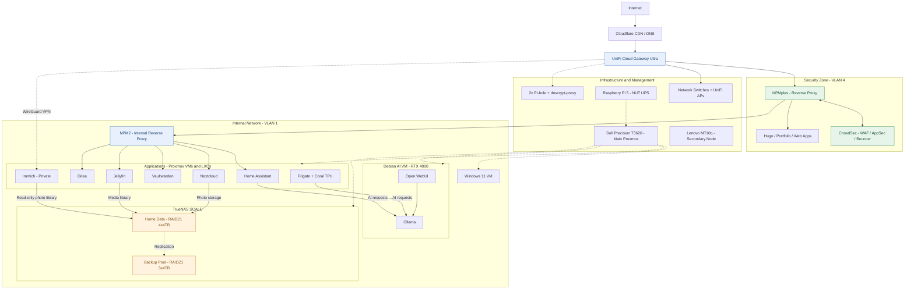

# NPMplus + CrowdSec WAF

I replaced the external Nginx Proxy Manager on my Debian VM (website hosting) with **NPMplus + CrowdSec AppSec** to strengthen homelab security.

## Architecture

Requests pass through Cloudflare and the UniFi Gateway before reaching the external reverse proxy. NPMplus handles proxying, while CrowdSec AppSec provides web application firewall inspection at this entry point.

NPMplus serves the websites in the security zone (VLAN 4) and forwards application requests to NPM2 in the internal network (VLAN 1). NPM2 routes those requests to the appropriate homelab service. Private Immich access uses WireGuard VPN.

[Back to the homelab overview](../README.md)
