# Secure Vaultwarden installation behind Cloudflare and two Nginx Proxy Managers

This publication-safe template describes a hardened Vaultwarden deployment.

It is written for a personal or family Vaultwarden server containing sensitive information such as passwords, identity documents, and payment cards.

> [!IMPORTANT]
> Replace every uppercase placeholder with your own value before using the configuration. Never publish `.env`, backups, access tokens, recovery codes, private keys, public IP addresses, internal IP addresses, email addresses, or account names.

## 1. Architecture

```mermaid
flowchart LR
    Client[Bitwarden client or browser]
    CF[Cloudflare proxy]
    FW[Edge firewall]
    NPM1[NPM1 isolated VLAN<br/>NPM1_PRIVATE_IP]
    NPM2[NPM2 trusted LAN<br/>NPM2_PRIVATE_IP]
    VW[Vaultwarden LXC<br/>VAULTWARDEN_PRIVATE_IP:8080]

    Client -->|HTTPS| CF
    CF -->|HTTPS 443| FW
    FW -->|Only Cloudflare source ranges| NPM1
    NPM1 -->|Verified HTTPS 443| NPM2
    NPM2 -->|HTTP 8080 on trusted LAN| VW
```



Placeholders used throughout this guide:

| Item | Value |
|---|---|
| Public hostname | `vault.example.com` |
| NPM1, isolated VLAN | `NPM1_PRIVATE_IP` |
| NPM2, trusted LAN | `NPM2_PRIVATE_IP` |
| Vaultwarden LXC | `VAULTWARDEN_PRIVATE_IP` |
| Vaultwarden published port | `VAULTWARDEN_PRIVATE_IP:8080` |
| Docker bridge gateway | `DOCKER_BRIDGE_GATEWAY` |

## 2. Security goals

This configuration provides:

- TLS from the client to Cloudflare.
- TLS from Cloudflare to NPM1.
- Verified TLS from NPM1 to NPM2.
- No direct Internet connection to Vaultwarden.
- Public access to Vaultwarden only through Cloudflare.
- A public `404` response for `/admin`.
- Correct real client IP addresses for logging and rate limiting.
- Disabled public registrations, invitations, and password hints.
- Protection against Vaultwarden fetching private-network URLs.
- Two-step login and a strong account KDF.
- Backups and controlled update procedures.

No Internet-facing service is perfectly safe. Strong passwords, two-step login, updates, restricted networking, and tested backups must all remain in place.

## 3. Prerequisites

- An unprivileged Proxmox LXC with a fixed IP address.
- Docker Engine and Docker Compose installed inside the LXC.
- A Cloudflare-managed domain.
- Two Nginx Proxy Manager instances.
- A valid certificate for the Vaultwarden hostname on both NPM instances.
- Correct time synchronization on the LXC, proxies, and client devices.

This guide assumes that Docker is already installed and that the working directory is `/root/vaultwarden`.

## 4. Create the Vaultwarden files

Create the directory:

```bash
install -d -m 700 /root/vaultwarden/data
cd /root/vaultwarden
```

### 4.1 Generate a protected admin token

Generate an Argon2id hash using Vaultwarden itself:

```bash
docker run --rm -it vaultwarden/server:1.37.4 /vaultwarden hash
```

Enter a long, unique admin password twice. Save the generated `$argon2id$...` value temporarily in a secure place.

Check the [official Vaultwarden releases](https://github.com/dani-garcia/vaultwarden/releases) and replace the example image tag with the current stable version when reproducing the installation.

### 4.2 Create `.env`

Create `/root/vaultwarden/.env`:

```dotenv
# Public address
DOMAIN=https://vault.example.com

# Accounts
SIGNUPS_ALLOWED=false
SIGNUPS_VERIFY=false
INVITATIONS_ALLOWED=false
PASSWORD_HINTS_ALLOWED=false
SHOW_PASSWORD_HINT=false

# Administration
# Use the Argon2id PHC value generated above.
# Single quotes preserve the dollar signs in a Docker Compose .env file.
ADMIN_TOKEN='$argon2id$v=19$m=65540,t=3,p=4$REPLACE_WITH_YOUR_HASH'
ADMIN_SESSION_LIFETIME=20

# General
TZ=Etc/UTC
LOG_LEVEL=warn
EXTENDED_LOGGING=true
WEB_VAULT_ENABLED=true

# Reverse proxies and real client addresses
IP_HEADER=X-Forwarded-For
IP_HEADER_TRUSTED_PROXIES=DOCKER_BRIDGE_GATEWAY,NPM2_PRIVATE_IP,NPM1_PRIVATE_IP

# Stop favicon and other HTTP fetches from reaching private networks
HTTP_REQUEST_BLOCK_NON_GLOBAL_IPS=true
```

Use the actual Docker bridge gateway shown by this command:

```bash
docker inspect vaultwarden --format \
  '{{range .NetworkSettings.Networks}}{{.Gateway}}{{println}}{{end}}'
```

The container will not exist during a new installation. After its first start, check the gateway and correct `IP_HEADER_TRUSTED_PROXIES` if necessary.

Optional settings for a personal server:

```dotenv
# Prevent users from creating additional organizations.
ORG_CREATION_USERS=none

# Disable Bitwarden Send if it is not used.
SENDS_ALLOWED=false
```

Apply restrictive permissions:

```bash
chmod 600 /root/vaultwarden/.env
chmod 700 /root/vaultwarden/data
```

### 4.3 Create `docker-compose.yml`

Create `/root/vaultwarden/docker-compose.yml`:

```yaml
name: vaultwarden

services:
  vaultwarden:
    image: vaultwarden/server:1.37.4
    container_name: vaultwarden
    hostname: vaultwarden
    restart: unless-stopped

    env_file:
      - .env

    volumes:
      - ./data:/data

    ports:
      - "VAULTWARDEN_PRIVATE_IP:8080:80"

    security_opt:
      - no-new-privileges:true

    healthcheck:
      test:
        - CMD
        - /healthcheck.sh
      interval: 30s
      timeout: 10s
      retries: 3
      start_period: 30s

    logging:
      driver: json-file
      options:
        max-size: "10m"
        max-file: "3"
```

The host address in `ports` is important. It prevents Docker from listening on every IPv4 and IPv6 interface.

Validate and start:

```bash
cd /root/vaultwarden
docker compose config --quiet
docker compose up -d
```

Verify:

```bash
docker ps --format 'table {{.Names}}\t{{.Image}}\t{{.Ports}}'
docker port vaultwarden 80/tcp
docker inspect vaultwarden --format \
  'state={{.State.Status}} health={{if .State.Health}}{{.State.Health.Status}}{{else}}none{{end}}'
curl -fsS http://VAULTWARDEN_PRIVATE_IP:8080/alive
```

Expected results:

- The port is `VAULTWARDEN_PRIVATE_IP:8080->80/tcp`.
- The container is `running` and `healthy`.
- `/alive` returns a timestamp.

Verify the important environment variables without printing the admin token:

```bash
docker exec vaultwarden sh -c '
printf "DOMAIN=%s\n" "$DOMAIN"
printf "PASSWORD_HINTS_ALLOWED=%s\n" "$PASSWORD_HINTS_ALLOWED"
printf "HTTP_REQUEST_BLOCK_NON_GLOBAL_IPS=%s\n" "$HTTP_REQUEST_BLOCK_NON_GLOBAL_IPS"
printf "IP_HEADER=%s\n" "$IP_HEADER"
printf "IP_HEADER_TRUSTED_PROXIES=%s\n" "$IP_HEADER_TRUSTED_PROXIES"
case "$ADMIN_TOKEN" in
  \$argon2id\$*) echo "ADMIN_TOKEN=argon2id" ;;
  *) echo "ADMIN_TOKEN=ERROR" ;;
esac
'
```

## 5. Configure NPM2 on the trusted LAN

Create a Proxy Host for `vault.example.com`.

### Details

| Setting | Value |
|---|---|
| Scheme | `http` |
| Forward hostname/IP | `VAULTWARDEN_PRIVATE_IP` |
| Forward port | `8080` |
| Cache assets | Off |
| Block common exploits | On |
| WebSockets support | On |

### SSL

- Select a valid certificate for `vault.example.com`.
- Enable **Force SSL**.
- Enable **HTTP/2 Support**.
- Enable **HSTS** only after HTTPS works correctly.

For attachment uploads, use a finite size suitable for your needs on both proxies. For example:

```nginx
client_max_body_size 525M;
proxy_read_timeout 3600s;
```

`client_max_body_size` is an upload limit, not a security feature. A smaller value reduces resource abuse. Cloudflare may impose a lower upload limit depending on the account plan.

Test NPM2 from a trusted-LAN computer:

```bash
curl --connect-timeout 5 --max-time 15 \
  --resolve vault.example.com:443:NPM2_PRIVATE_IP \
  -sS -o /dev/null -w 'HTTP=%{http_code}\n' \
  https://vault.example.com/alive
```

Expected: `HTTP=200`.

## 6. Configure NPM1 in the isolated VLAN

Create a Proxy Host for `vault.example.com`.

### Details

| Setting | Value |
|---|---|
| Scheme | `https` |
| Forward hostname/IP | `NPM2_PRIVATE_IP` |
| Forward port | `443` |
| Cache assets | Off |
| Block common exploits | On |
| WebSockets support | On |

### SSL

- Select a valid certificate for `vault.example.com`.
- Enable **Force SSL**.
- Enable **HTTP/2 Support**.
- Enable **HSTS** only after HTTPS works correctly.

### Advanced configuration

Verify the NPM2 certificate and hide the admin page from the public route:

```nginx
proxy_ssl_server_name on;
proxy_ssl_name vault.example.com;
proxy_ssl_verify on;
proxy_ssl_trusted_certificate /etc/ssl/certs/ca-certificates.crt;
proxy_ssl_verify_depth 3;

location = /admin {
    return 404;
}

location ^~ /admin/ {
    return 404;
}
```

After saving, test NPM1:

```bash
curl --connect-timeout 5 --max-time 15 \
  --resolve vault.example.com:443:NPM1_PRIVATE_IP \
  -sS -o /dev/null -w 'ALIVE=%{http_code}\n' \
  https://vault.example.com/alive

curl --connect-timeout 5 --max-time 15 \
  --resolve vault.example.com:443:NPM1_PRIVATE_IP \
  -sS -o /dev/null -w 'ADMIN=%{http_code}\n' \
  https://vault.example.com/admin
```

Expected:

```text
ALIVE=200
ADMIN=404
```

## 7. Restore the real client IP at NPM1

NPM1 must trust `CF-Connecting-IP` only when the connection actually comes from Cloudflare.

Download the current Cloudflare address lists from:

- <https://www.cloudflare.com/ips-v4/>
- <https://www.cloudflare.com/ips-v6/>

For every network in those lists, add a `set_real_ip_from` directive to the Nginx configuration used by NPM1. Then add:

```nginx
real_ip_header CF-Connecting-IP;
real_ip_recursive on;
```

Example only:

```nginx
set_real_ip_from CLOUDFLARE_IPV4_OR_IPV6_CIDR;
real_ip_header CF-Connecting-IP;
real_ip_recursive on;
```

Do not use `set_real_ip_from 0.0.0.0/0`. That would let arbitrary clients forge their source address.

Maintain the Cloudflare address list when Cloudflare changes it. The edge firewall must use the same current lists.

Verify from a phone using 4G or 5G:

1. Open `https://vault.example.com/alive?ip-check=TEST`.
2. Inspect the NPM1 access log.
3. Confirm the logged client address is the phone's public address, not a Cloudflare address.

Correct client addresses are required for useful logs and accurate Vaultwarden login rate limiting.

## 8. Configure Cloudflare

### DNS

Create an `A` or `AAAA` record:

```text
vault.example.com -> PUBLIC_ORIGIN_IP
```

Enable the orange **Proxied** cloud.

### TLS

Set:

```text
SSL/TLS encryption mode: Full (strict)
```

This makes Cloudflare validate the certificate presented by NPM1.

### Cache

Create a Cache Rule:

```text
If hostname equals vault.example.com
Cache eligibility: Bypass
```

Place it after any broader rule that might cache the same hostname. Vault API responses and authenticated pages must not be cached.

### HTTP/3

HTTP/3 is optional. If Chrome reports `ERR_QUIC_PROTOCOL_ERROR` only for this hostname, temporarily disable **HTTP/3 with QUIC** in Cloudflare and use HTTP/2. Disabling HTTP/3 does not weaken TLS encryption and does not require opening UDP port 443 on the home firewall.

## 9. Firewall policy

Use a default-deny policy and allow only the required flows.

| Source | Destination | Port | Action |
|---|---|---:|---|
| Current Cloudflare IPv4/IPv6 ranges | NPM1 `NPM1_PRIVATE_IP` | TCP 443 | Allow |
| NPM1 `NPM1_PRIVATE_IP` | NPM2 `NPM2_PRIVATE_IP` | TCP 443 | Allow |
| NPM2 `NPM2_PRIVATE_IP` | Vaultwarden `VAULTWARDEN_PRIVATE_IP` | TCP 8080 | Allow |
| Any other source | Vaultwarden `VAULTWARDEN_PRIVATE_IP` | TCP 8080 | Deny |

Port-forward public TCP 443 only to NPM1. Do not forward any public port directly to NPM2 or Vaultwarden.

> [!IMPORTANT]
> If NPM2 and Vaultwarden are on the same subnet, their traffic does not cross the network gateway. Enforce the final `NPM2 -> Vaultwarden` rule with the hypervisor firewall, container firewall, or a carefully tested Docker host rule.

Docker-published ports can bypass ordinary host firewall arrangements. Confirm the restriction from another LAN device rather than assuming the rule works.

Required result:

- `NPM2_PRIVATE_IP` can reach `VAULTWARDEN_PRIVATE_IP:8080`.
- Other LAN and VLAN devices cannot reach `VAULTWARDEN_PRIVATE_IP:8080`.

## 10. Configure the Vaultwarden account

### Master password

Use a long, unique master password that is never used on another service. Do not store the only copy inside the same vault.

### KDF

In the account security settings, select **Argon2id** and use the current values recommended by the Bitwarden client. One suitable example is:

| Setting | Value |
|---|---:|
| Memory | 32 MiB |
| Iterations | 6 |
| Parallelism | 4 |

Changing the KDF re-protects the account key. It does not replace or rotate all stored encryption keys.

### Two-step login

1. Enable an authenticator application.
2. Preferably register two FIDO2 security keys or passkeys.
3. Test both keys before removing any fallback method.
4. View the two-step recovery code.
5. Print or write the recovery code and store it outside Vaultwarden.
6. Never send the recovery code through chat or email.

Keep one hardware key with you and a second key in a separate safe location.

## 11. End-to-end validation

### 11.1 Confirm Cloudflare is serving the request

From an external connection:

```bash
curl -sSI https://vault.example.com/alive \
  | grep -iE '^(server|cf-ray|cf-cache-status):'
```

Expected values include:

```text
server: cloudflare
cf-cache-status: DYNAMIC
cf-ray: ...
```

### 11.2 Confirm the admin page is hidden

```bash
curl -sS -o /dev/null -w 'ADMIN=%{http_code}\n' \
  https://vault.example.com/admin
```

Expected: `ADMIN=404`.

### 11.3 Confirm WebSockets

Run through NPM2, NPM1, and the public hostname:

```bash
curl -i --http1.1 'https://vault.example.com/notifications/hub?access_token=invalid-test-token' \
  -H 'Sec-WebSocket-Version: 13' \
  -H 'Sec-WebSocket-Key: 36M0mX7Fl2JgMBdnGfEpsQ==' \
  -H 'Connection: Upgrade' \
  -H 'Upgrade: websocket'
```

A successful protocol upgrade begins with:

```text
HTTP/1.1 101 Switching Protocols
```

### 11.4 Test a real client

Using a phone on 4G or 5G:

1. Sign in with a native Bitwarden client.
2. Complete two-step login.
3. Create a temporary vault item.
4. Sync another client and confirm the item appears.
5. Upload a small attachment.
6. Download the attachment.
7. Delete the temporary item and attachment.

## 12. Protect access logs

Bitwarden clients open a WebSocket URL similar to:

```text
/notifications/hub?access_token=JWT_TOKEN
```

A reverse proxy can record that temporary token in its access log.

- Keep NPM logs readable only by administrators.
- Use short log retention and rotation.
- Do not send unredacted logs to a public or third-party log service.
- Redact the `access_token` query value where the logging system supports it.
- Never paste a complete `/notifications/hub?...` log line into a support request.

Vaultwarden's internal logging truncates query strings, but an external reverse proxy may not.

## 13. Backups

A backup stored only inside the Vaultwarden LXC is not sufficient. If the LXC storage fails, both the server and backup may be lost.

### 13.1 Immediate cold backup

This method briefly stops Vaultwarden and creates a consistent copy:

```bash
cd /root/vaultwarden
backup_dir="/root/vaultwarden-backup-$(date +%Y%m%d-%H%M%S)"
install -d -m 700 "$backup_dir"
cp -a .env docker-compose.yml "$backup_dir/"
docker stop vaultwarden
cp -a data "$backup_dir/data"
docker start vaultwarden
chmod -R go-rwx "$backup_dir"
echo "Backup created at: $backup_dir"
```

Copy the resulting directory to encrypted storage on another machine.

### 13.2 Online SQLite backup

Vaultwarden provides a safe SQLite backup command:

```bash
docker exec vaultwarden /vaultwarden backup
```

This backs up the database. It does not replace backups of attachments, Sends, `.env`, `docker-compose.yml`, and the `rsa_key*` files.

### 13.3 Required backup policy

- Run an automatic backup at least daily.
- Keep at least one encrypted copy on another machine or storage system.
- Keep several historical versions.
- Protect backup encryption credentials separately.
- Perform a test restoration periodically.
- Never rely only on a Proxmox snapshot.

When restoring an online SQLite backup, stop Vaultwarden and avoid combining the restored database with an old, mismatched `db.sqlite3-wal` file. Follow the [official backup and restoration procedure](https://github.com/dani-garcia/vaultwarden/wiki/Backing-up-your-vault).

## 14. Controlled updates

Do not leave Vaultwarden unpatched, and do not install blind unattended updates to a password manager.

### Before every update

1. Read the [release notes](https://github.com/dani-garcia/vaultwarden/releases).
2. Create an online database backup.
3. Confirm an off-host backup exists.
4. Change the image tag in `docker-compose.yml` to the new stable version.

### Update commands

```bash
cd /root/vaultwarden
docker exec vaultwarden /vaultwarden backup
docker compose config --quiet
docker compose pull
docker compose up -d
```

### Verify after updating

```bash
docker exec vaultwarden /vaultwarden --version
docker inspect vaultwarden --format \
  'state={{.State.Status}} health={{if .State.Health}}{{.State.Health.Status}}{{else}}none{{end}}'
curl -fsS http://VAULTWARDEN_PRIVATE_IP:8080/alive
```

Then repeat the public `/alive`, `/admin`, WebSocket, sign-in, sync, upload, and download tests.

## 15. Regular security checklist

### Every week

- Check for Vaultwarden security releases.
- Check container health.
- Review failed login and proxy logs for unusual activity.
- Confirm the latest automatic backup succeeded.

### Every month

- Test the public `/admin` response remains `404`.
- Confirm the Cloudflare cache bypass rule still applies.
- Confirm the origin firewall still accepts only Cloudflare source ranges.
- Confirm real client IP addresses still appear in logs.
- Check that all users still have two-step login enabled.

### Every few months

- Restore a backup into an isolated test instance.
- Test both FIDO2 keys or passkeys.
- Confirm the recovery code remains available offline.
- Review Cloudflare's current IPv4 and IPv6 ranges.
- Review NPM and Proxmox updates.

## 16. Final expected state

- Vaultwarden reports healthy.
- The installed Vaultwarden version matches the current stable release.
- The public login and native clients work.
- Upload, download, and synchronization work externally.
- Cloudflare reports `DYNAMIC`, not a cached response.
- `/admin` returns `404` through the public path.
- WebSocket negotiation returns `101 Switching Protocols`.
- Logs show the real external client address.
- Only NPM2 can reach Vaultwarden TCP 8080.
- Registrations, invitations, and password hints are disabled.
- Argon2id and two-step login are enabled.
- Recovery material is stored offline.
- Automatic encrypted off-host backups and restore tests are operational.

## Official references

- [Vaultwarden repository](https://github.com/dani-garcia/vaultwarden)
- [Vaultwarden environment template](https://github.com/dani-garcia/vaultwarden/blob/main/.env.template)
- [Vaultwarden hardening guide](https://github.com/dani-garcia/vaultwarden/wiki/Hardening-Guide)
- [Vaultwarden proxy examples](https://github.com/dani-garcia/vaultwarden/wiki/Proxy-examples)
- [Vaultwarden admin-page security](https://github.com/dani-garcia/vaultwarden/wiki/Enabling-admin-page)
- [Vaultwarden backup guide](https://github.com/dani-garcia/vaultwarden/wiki/Backing-up-your-vault)
- [Vaultwarden releases](https://github.com/dani-garcia/vaultwarden/releases)
- [Cloudflare IP ranges](https://www.cloudflare.com/ips/)
- [Bitwarden KDF documentation](https://bitwarden.com/help/kdf-algorithms/)
- [Bitwarden FIDO2 two-step login](https://bitwarden.com/help/setup-two-step-login-fido/)
- [Bitwarden two-step recovery code](https://bitwarden.com/help/two-step-recovery-code/)
